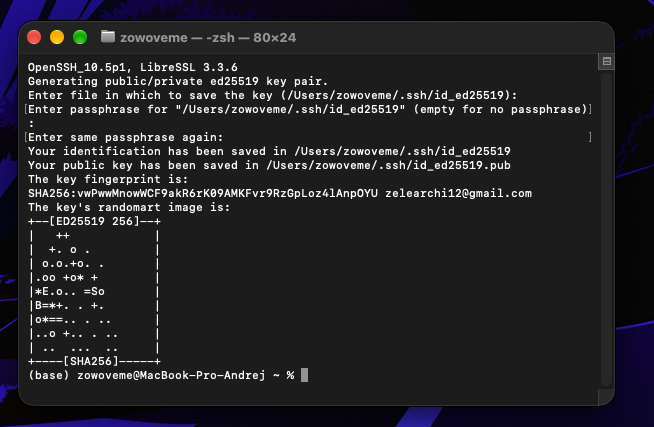
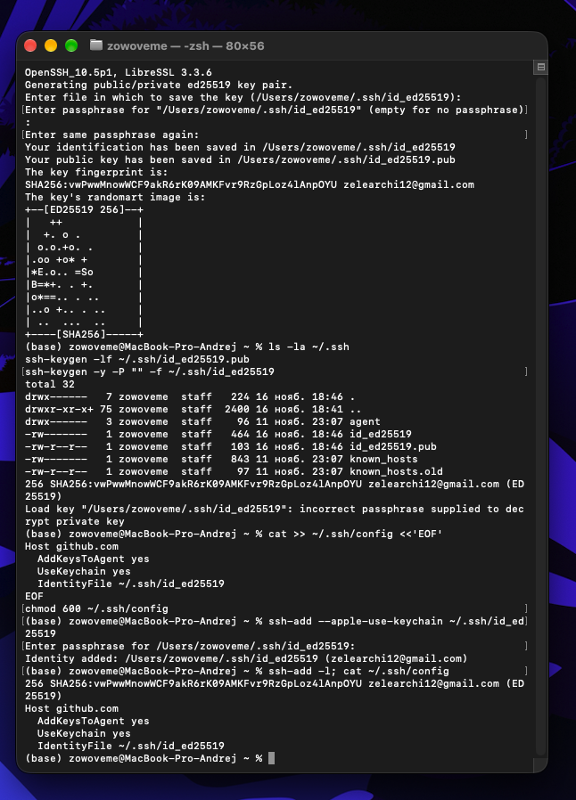
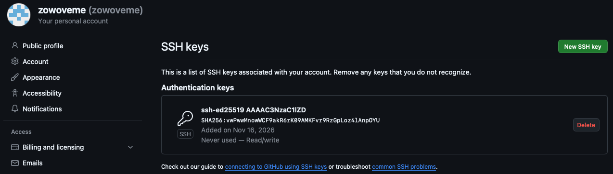
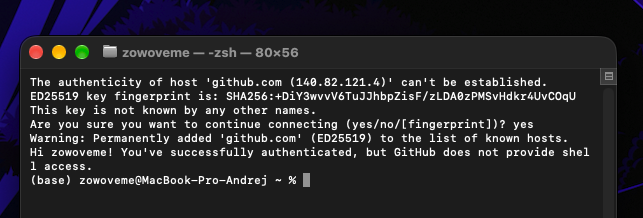
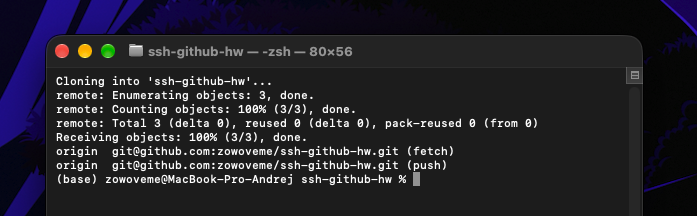
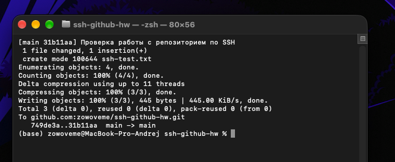

# Настройка SSH-доступа к GitHub

**Выполнил:** Аргунов Андрей Александрович
**Дата:** 16.11.2026
**Репозиторий:** https://github.com/zowoveme/ssh-github-hw
**SSH-URL:** `git@github.com:zowoveme/ssh-github-hw.git`

**Окружение:** macOS (MacBook Pro), OpenSSH_10.5p1 / LibreSSL 3.3.6, git 2.54.0 (Apple Git-157)

| № | Кейс | Результат |
|---|------|-----------|
| 1 | Установка SSH-клиента и генерация ключевой пары | ✅ ключ ed25519 с passphrase в `~/.ssh/` |
| 2 | Добавление публичного ключа в GitHub | ✅ ключ в Settings → SSH and GPG keys |
| 3 | Проверка SSH-подключения | ✅ `Hi zowoveme! You've successfully authenticated` |
| 4 | Работа с репозиторием по SSH | ✅ clone, commit и push без ввода пароля |

---

## 1. Установка SSH-клиента и генерация ключевой пары

### 1.1. Проверка наличия SSH-клиента

В macOS SSH-клиент (OpenSSH) встроен в систему:

```bash
ssh -V
```
```
OpenSSH_10.5p1, LibreSSL 3.3.6
```

Перед генерацией проверено, что в `~/.ssh/` ещё нет ключей (там были только `known_hosts`), поэтому существующие ключи не будут перезаписаны.

### 1.2. Генерация ключевой пары ed25519

```bash
ssh-keygen -t ed25519 -C "zelearchi12@gmail.com"
```

- путь: по умолчанию `~/.ssh/id_ed25519`;
- **passphrase** задан (вводится дважды, на экране не отображается).

```
Your identification has been saved in /Users/zowoveme/.ssh/id_ed25519
Your public key has been saved in /Users/zowoveme/.ssh/id_ed25519.pub
The key fingerprint is:
SHA256:vwPwwMnowWCF9akR6rK09AMKFvr9RzGpLoz4lAnpOYU zelearchi12@gmail.com
```



### 1.3. Проверка ключей

```bash
ls -la ~/.ssh                              # файлы ключей и права доступа
ssh-keygen -lf ~/.ssh/id_ed25519.pub       # тип и fingerprint публичного ключа
ssh-keygen -y -P "" -f ~/.ssh/id_ed25519   # попытка открыть приватный ключ БЕЗ пароля
```
```
-rw-------  1 zowoveme  staff  464 16 нояб. 18:46 id_ed25519
-rw-r--r--  1 zowoveme  staff  103 16 нояб. 18:46 id_ed25519.pub
256 SHA256:vwPwwMnowWCF9akR6rK09AMKFvr9RzGpLoz4lAnpOYU zelearchi12@gmail.com (ED25519)
Load key "/Users/zowoveme/.ssh/id_ed25519": incorrect passphrase supplied to decrypt private key
```

Что проверено:
- приватный ключ `id_ed25519` имеет права `600` (доступ только у владельца), публичный `id_ed25519.pub` — `644`;
- публичный ключ корректен: тип **ED25519**, 256 бит;
- **приватный ключ защищён passphrase**: с пустым паролем он не открывается (`incorrect passphrase`).

### 1.4. ssh-agent и связка ключей macOS

Чтобы ключ оставался защищён паролем, но не требовал ввода пароля при каждом подключении, passphrase один раз передаётся в ssh-agent и сохраняется в связке ключей macOS (Keychain).

Файл `~/.ssh/config`:
```
Host github.com
  AddKeysToAgent yes
  UseKeychain yes
  IdentityFile ~/.ssh/id_ed25519
```

```bash
chmod 600 ~/.ssh/config
ssh-add --apple-use-keychain ~/.ssh/id_ed25519   # passphrase вводится один раз
ssh-add -l                                       # ключ загружен в агент
```
```
Identity added: /Users/zowoveme/.ssh/id_ed25519 (zelearchi12@gmail.com)
256 SHA256:vwPwwMnowWCF9akR6rK09AMKFvr9RzGpLoz4lAnpOYU zelearchi12@gmail.com (ED25519)
```



---

## 2. Добавление публичного ключа в аккаунт GitHub

Публичный ключ скопирован в буфер обмена:

```bash
pbcopy < ~/.ssh/id_ed25519.pub
```

Затем на GitHub: **Settings → SSH and GPG keys → New SSH key**, тип *Authentication Key*, ключ вставлен в поле *Key* → **Add SSH key**.


Fingerprint ключа на GitHub (`SHA256:vwPwwMnow…lAnpOYU`) совпадает с локальным из п. 1.3, значит, добавлен именно сгенерированный ключ.



---

## 3. Проверка SSH-подключения к GitHub

```bash
ssh -T git@github.com
```
```
The authenticity of host 'github.com (140.82.121.4)' can't be established.
ED25519 key fingerprint is: SHA256:+DiY3wvvV6TuJJhbpZisF/zLDA0zPMSvHdkr4UvCOqU
Are you sure you want to continue connecting (yes/no/[fingerprint])? yes
Warning: Permanently added 'github.com' (ED25519) to the list of known hosts.
Hi zowoveme! You've successfully authenticated, but GitHub does not provide shell access.
```

- При первом подключении SSH попросил подтвердить ключ сервера. Отпечаток `SHA256:+DiY3wvvV6TuJJhbpZisF/zLDA0zPMSvHdkr4UvCOqU` совпадает с официальным ED25519-ключом GitHub, после подтверждения он сохранён в `known_hosts`.
- GitHub вернул **аутентифицированное приветствие** с именем аккаунта `zowoveme`.
- **Пароль не запрашивался**: ключ предоставлен ssh-agent.



---

## 4. Работа с репозиторием по SSH

### 4.1. Клонирование по SSH-URL

На GitHub создан публичный репозиторий `ssh-github-hw` (с README). Клонирование:

```bash
mkdir -p ~/projects && cd ~/projects
git clone git@github.com:zowoveme/ssh-github-hw.git
cd ssh-github-hw
git remote -v
```
```
Cloning into 'ssh-github-hw'...
Receiving objects: 100% (3/3), done.
origin  git@github.com:zowoveme/ssh-github-hw.git (fetch)
origin  git@github.com:zowoveme/ssh-github-hw.git (push)
```

`git remote -v` показывает адрес вида `git@github.com:…`: репозиторий подключён по SSH, а не по HTTPS.



### 4.2. Коммит и push

```bash
git config user.name "Андрей Аргунов"
git config user.email "zelearchi12@gmail.com"
echo "Проверка push по SSH — $(date)" > ssh-test.txt
git add ssh-test.txt
git commit -m "Проверка работы с репозиторием по SSH"
git push
```
```
[main 31b11aa] Проверка работы с репозиторием по SSH
 1 file changed, 1 insertion(+)
 create mode 100644 ssh-test.txt
...
To github.com:zowoveme/ssh-github-hw.git
   749de3a..31b11aa  main -> main
```

`git push` выполнен **без запроса пароля**: аутентификация прошла по SSH-ключу через агент. Этот README и скриншоты тоже загружены в репозиторий через `git push` по SSH.



---

## Итоги

- SSH-клиент присутствует в системе (OpenSSH 10.5p1).
- Сгенерирована пара ключей **ed25519**. Приватный ключ защищён passphrase и имеет права `600`, публичный ключ корректен.
- Публичный ключ добавлен в GitHub, fingerprint совпадает с локальным.
- `ssh -T git@github.com` возвращает аутентифицированное приветствие.
- Репозиторий клонирован по SSH-URL, коммит отправлен `git push` без ввода пароля.
- Сочетание «ключ с паролем + работа без ввода пароля» обеспечено через **ssh-agent и связку ключей macOS**: passphrase вводится один раз, приватный ключ при этом остаётся зашифрованным на диске.
